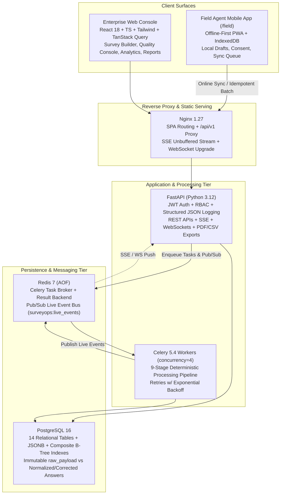

# SurveyOps — System Architecture

SurveyOps is a multi-tier enterprise field survey and data intelligence platform architected for **offline-first mobile resilience**, **strict raw-source immutability**, **asynchronous multi-stage validation**, and **high-scale PostgreSQL analytics**.

---

## 1. High-Level System Architecture

---

## 2. Architectural Design Decisions

### 2.1 Immutable Survey Versioning
- Publishing a survey locks its `SurveyVersion` (`status='published'`) with a SHA-256 `schema_hash`.
- Subsequent edits create a cloned draft (`version_number + 1`) without mutating historical `questions` or `validation_rules`.
- Every `Response` references both `survey_id` and `survey_version_id`, guaranteeing reproducible schema validation and accurate longitudinal analytics.

### 2.2 Offline-First Mobile Collection & Idempotent Ingestion
- The Field Agent application (`/field`) maintains three **IndexedDB** (`surveyops_field_v1`) object stores:
  - `cached_assignments` — offline snapshot of active survey assignments and complete question/branching schemas.
  - `drafts` — in-progress interviews saved locally to prevent loss across browser/device interruptions.
  - `submission_queue` — completed interviews queued with a client-generated UUID `client_submission_id` and explicit state machine (`local_saved` → `syncing` → `synced` | `failed`).
- On the backend, `responses.client_submission_id` enforces a **PostgreSQL UNIQUE index**. Replaying an identical submission ID returns `idempotent_replay: true` with zero duplicate records.

### 2.3 Privacy-by-Design Consent & Geolocation Enforcement
- Informed consent is an explicit prerequisite before entering the questionnaire.
- Location capture uses an independent opt-in toggle (`location_consent_given`). Even if coordinates are sent by a misbehaving client when `location_consent_given=false` or `survey.allow_location_capture=false`, the FastAPI ingestion layer strictly nullifies `latitude`, `longitude`, and `location_accuracy_m` before persistence.

### 2.4 Write-Once Raw Data & Layered Answer Provenance
- Raw submissions persist verbatim inside `responses.raw_payload` and `response_answers.raw_value` and are **never modified** by automated pipeline normalization or human analysts.
- Automated cleaning populates `normalized_value`; analyst corrections populate `corrected_value` with a mandatory `correction_reason` and `AuditEvent`.
- Indexed analytical projections (`numeric_value`, `text_value`, `effective_value`) keep SQL aggregations fast and consistent with analyst approvals.

### 2.5 Asynchronous Pipeline & Real-Time Event Streaming
- Single responses (`POST /api/v1/responses`) and batch sync payloads (`POST /api/v1/responses/batch`) persist raw records immediately, create tracked `ProcessingJob` records, and enqueue Celery tasks onto Redis.
- If the Celery broker is unavailable during local unit testing or degraded mode, the API gracefully falls back to synchronous pipeline execution rather than dropping submissions.
- Completed pipeline runs, survey publications, and analyst review decisions publish JSON events to Redis channel `surveyops:live_events`. FastAPI streams these live over Server-Sent Events (`/api/v1/events/stream`) and WebSockets (`/api/v1/ws/live`), automatically refreshing dashboard telemetry and invalidating stale React Query caches.

---

## 3. Infrastructure & Deployment Topology

Managed via `docker-compose.yml` with explicit healthchecks and isolated named volumes:

| Service | Container | Internal Port | Host Port (`.env`) | Role |
|---|---|---|---|---|
| `postgres` | `surveyops-postgres` | `5432` | `5472` | Primary PostgreSQL 16 database (`surveyops_pgdata`) |
| `redis` | `surveyops-redis` | `6379` | `6382` | Celery broker, result backend, pub/sub bus (`surveyops_redis`) |
| `backend` | `surveyops-backend` | `8000` | `8070` | FastAPI app; runs `alembic upgrade head` & idempotent seed on boot |
| `worker` | `surveyops-worker` | — | — | Celery worker (`--concurrency=4`) executing 9-stage pipeline jobs |
| `frontend` | `surveyops-frontend` | `80` | `3070` | Nginx serving production Vite bundle + unbuffered `/api/` reverse proxy |

---

## 4. Security & Observability

- **Authentication:** Stateless JWT (`HS256`, configurable expiration via `ACCESS_TOKEN_EXPIRE_MINUTES`) paired with `bcrypt` password hashing.
- **Authorization:** Server-side `require_roles(...)` FastAPI dependency enforces `admin`, `analyst`, and `field_agent` boundaries on every endpoint; UI routes mirror permissions with `<ProtectedRoute roles={[...]}>`.
- **Structured Logging:** JSON-formatted application logs (`backend/app/core/logging.py`) attach an `X-Request-ID` correlation header, HTTP method, route, status code, and millisecond latency to every request.
- **Auditability:** All mutations across surveys, versions, assignments, responses, corrections, quality decisions, and reports write structured rows to `audit_events`.

---

## 5. Measured Scalability & Performance Profile

Measured empirically on Docker Desktop (WSL2 Linux 6.18, 16 vCPU, Python 3.12, PostgreSQL 16, Redis 7, Celery 5.4 — stored in `benchmarks/scale_100k_measured.json` and `benchmarks/locust_measured.json`):

| Benchmark Dimension | Measured Result | Configuration |
|---|---|---|
| **100k Batch Ingestion Throughput** | **560.6 responses/sec** (`1,681.7 answers/sec`) | 100,000 responses + 300,000 answers + 8,872 issues in `178.396s` (`batch_size=2000`) |
| **Idempotent Replay Check** | **0 duplicates inserted** (`271.97 ms`) | 500 already-ingested `client_submission_id` keys replayed via `ON CONFLICT DO NOTHING` |
| **Overview KPIs SQL (100k+ rows)** | **38.42 ms** | Composite index `ix_responses_survey_status_submitted` |
| **Daily Trends 30d SQL (100k+ rows)** | **38.21 ms** | Indexed `GROUP BY CAST(submitted_at AS DATE)` |
| **Geographic Breakdown SQL (100k+)** | **26.06 ms** | Composite index `ix_responses_survey_district_status` |
| **Deep Pagination (`OFFSET 50000`)** | **107.88 ms** | Indexed ordering on `submitted_at DESC` |
| **Locust API Load Test (25 users, 25s)** | **26.98 req/s**, **0.0% errors** | `p50: 42.0 ms`, `p95: 140.0 ms`, `p99: 190.0 ms` across 648 requests against 100k+ row DB |
