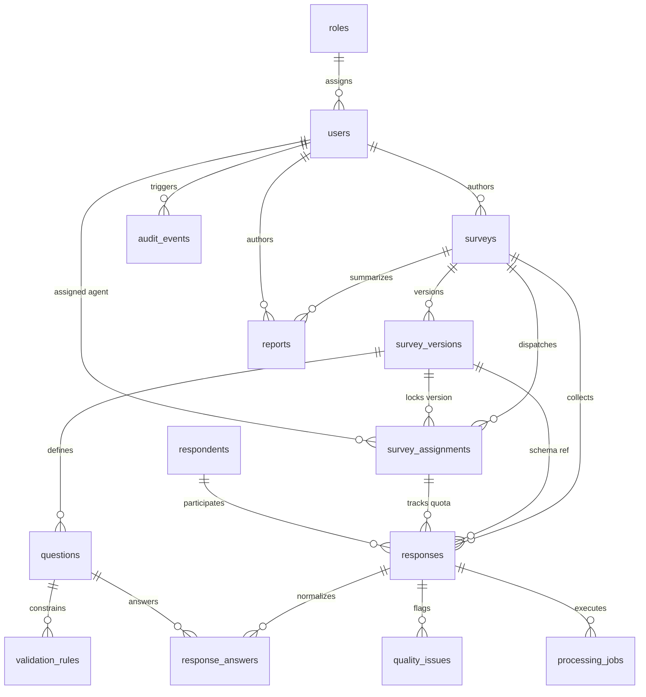

# SurveyOps — Relational Database Schema

SurveyOps uses **PostgreSQL 16** managed via **SQLAlchemy 2.0** ORM models (`backend/app/models/models.py`) and **Alembic** migrations (`backend/alembic/versions/0001_initial_schema.py`).

All 14 core entities use UUID primary keys, explicit foreign-key constraints, timezone-aware UTC timestamps (`TIMESTAMPTZ`), JSONB columns for flexible survey schemas/payloads, and composite B-tree indexes tuned for 100,000+ row analytical and operational queries.

---

## 1. Entity-Relationship Diagram

---

## 2. Core Tables Reference (14 Models)

### 2.1 Identity & Access
1. **`roles`**
   - `id` (UUID PK), `name` (UNIQUE, indexed: `admin`, `analyst`, `field_agent`), `description`, `permissions` (JSONB array), `created_at`.
2. **`users`**
   - `id` (UUID PK), `email` (UNIQUE, indexed), `full_name`, `hashed_password` (bcrypt), `role_id` (FK `roles.id`), `department`, `region`, `is_active`, `last_login_at`, `created_at`, `updated_at`.

### 2.2 Survey Authoring & Versioning
3. **`surveys`**
   - `id` (UUID PK), `code` (UNIQUE, indexed e.g. `CIV-2026-TRN`), `title`, `description`, `category` (indexed), `status` (`draft`, `published`, `archived`), `active_version_id` (FK `survey_versions.id`), `target_responses`, `requires_consent`, `allow_location_capture`, `instructions`, `consent_text`, `created_by_id` (FK `users.id`), `created_at`, `updated_at`.
4. **`survey_versions`**
   - `id` (UUID PK), `survey_id` (FK `surveys.id` CASCADE), `version_number`, `status` (`draft`, `published`, `retired`), `schema_hash` (SHA-256), `change_notes`, `published_at`, `published_by_id` (FK `users.id`), `created_at`.
   - Unique Constraint: `uq_survey_version_number (survey_id, version_number)`.
5. **`questions`**
   - `id` (UUID PK), `survey_version_id` (FK `survey_versions.id` CASCADE), `question_key`, `section_title`, `prompt`, `help_text`, `question_type`, `order_index`, `is_required`, `options` (JSONB), `conditional_logic` (JSONB), `config` (JSONB), `created_at`.
   - Unique Constraint: `uq_version_question_key (survey_version_id, question_key)`.
6. **`validation_rules`**
   - `id` (UUID PK), `question_id` (FK `questions.id` CASCADE), `rule_type`, `rule_config` (JSONB), `severity` (`critical`, `warning`, `info`), `error_message`, `is_active`, `created_at`.

### 2.3 Field Dispatch & Respondents
7. **`survey_assignments`**
   - `id` (UUID PK), `survey_id` (FK), `survey_version_id` (FK), `agent_id` (FK `users.id`), `assigned_by_id` (FK `users.id`), `region` (indexed), `target_count`, `collected_count`, `status` (`active`, `paused`, `completed`), `due_date`, `notes`, `created_at`, `updated_at`.
8. **`respondents`**
   - `id` (UUID PK), `external_ref` (indexed anonymized ref), `district` (indexed), `ward`, `age_bracket`, `household_size`, `consent_given`, `consent_timestamp`, `location_consent_given`, `metadata_json` (JSONB), `created_at`.

### 2.4 Ingestion, Normalization & Source Immutability
9. **`responses`**
   - `id` (UUID PK), `client_submission_id` (**UNIQUE**, indexed idempotency key), `survey_id`, `survey_version_id`, `assignment_id`, `agent_id`, `respondent_id`.
   - **Immutability separation:** `raw_payload` (JSONB — write-once source payload, never overwritten) vs `normalized_payload` (JSONB — cleaned analytical mirror).
   - **Pipeline state:** `processing_status` (`ingested`, `processing`, `validated`, `flagged`, `rejected`, `approved`, `failed`), `pipeline_stage`, `quality_score` (Float 0–100), `is_duplicate`, `duplicate_of_id` (self-FK), `fingerprint_hash` (SHA-256).
   - **Privacy & Context:** `consent_given`, `location_consent_given`, `latitude`, `longitude`, `location_accuracy_m`, `district`, `started_at`, `submitted_at`, `synced_at`, `duration_seconds`, `source_channel`, `device_info`.
   - **Analyst Review:** `reviewed_by_id`, `reviewed_at`, `review_notes`.
10. **`response_answers`**
    - `id` (UUID PK), `response_id` (FK CASCADE), `question_id` (FK CASCADE), `question_key`.
    - **Four-layer provenance:**
      - `raw_value` (JSONB — immutable raw field value)
      - `normalized_value` (JSONB — deterministic pipeline standardization)
      - `corrected_value` (JSONB nullable — explicit analyst override)
      - `effective_value` (JSONB — `COALESCE(corrected_value, normalized_value)` for clean analytics)
    - **Indexed SQL projection columns:** `numeric_value` (Float), `text_value` (VARCHAR 255) enabling fast SQL `GROUP BY`, `AVG`, `MIN`, `MAX`, and histogram queries without slow JSONB scans.
    - **Validation flags & correction metadata:** `is_valid`, `is_missing`, `is_outlier`, `corrected_by_id`, `corrected_at`, `correction_reason`.

### 2.5 Pipeline Jobs, Quality, Audit & Reports
11. **`processing_jobs`**
    - `id` (UUID PK), `batch_id`, `response_id`, `job_type`, `status` (`queued`, `running`, `completed`, `retrying`, `failed`), `current_stage`, `stages_completed` (JSONB timing log), `total_items`, `processed_items`, `failed_items`, `attempt_count`, `max_attempts`, `celery_task_id`, `error_message`, `started_at`, `completed_at`, `duration_ms`, `created_at`, `updated_at`.
12. **`quality_issues`**
    - `id` (UUID PK), `response_id` (FK CASCADE), `survey_id` (FK CASCADE), `question_id`, `question_key`, `issue_type`, `severity`, `status` (`open`, `resolved`, `dismissed`), `rule_code`, `message`, `detected_value` (JSONB), `expected_constraint` (JSONB), `resolved_by_id`, `resolved_at`, `resolution_note`, `created_at`.
13. **`audit_events`**
    - `id` (UUID PK), `entity_type`, `entity_id`, `action`, `actor_id`, `actor_type` (`user`, `pipeline`, `system`), `summary`, `before_state` (JSONB), `after_state` (JSONB), `metadata_json` (JSONB), `notify_level`, `is_read`, `created_at`.
14. **`reports`**
    - `id` (UUID PK), `survey_id` (FK CASCADE), `survey_version_id`, `title`, `report_type`, `status`, `filters_json` (JSONB), `summary_stats` (JSONB), `question_insights` (JSONB), `quality_summary` (JSONB), `geo_summary` (JSONB), `analyst_notes`, `created_by_id` (FK `users.id`), `created_at`, `updated_at`.

---

## 3. High-Scale Indexing Strategy

To sustain low-latency analytics and deep pagination across 100,000+ responses and 300,000+ normalized answers:

| Table | Index Name | Columns | Query Workload Accelerated |
|---|---|---|---|
| `responses` | `ix_responses_client_submission_id` | `(client_submission_id)` UNIQUE | Idempotent `ON CONFLICT` ingestion & offline retry deduplication |
| `responses` | `ix_responses_survey_status_submitted` | `(survey_id, processing_status, submitted_at)` | Paginated Response Registry, daily trends, KPI aggregations |
| `responses` | `ix_responses_survey_district_status` | `(survey_id, district, processing_status)` | Geographic distribution table & district-scoped filters |
| `responses` | `ix_responses_fingerprint_survey` | `(survey_id, fingerprint_hash, submitted_at)` | Sliding-window duplicate fingerprint detection |
| `responses` | `ix_responses_agent_submitted` | `(agent_id, submitted_at)` | Field enumerator performance and submission history |
| `response_answers` | `ix_response_answers_question_text` | `(question_id, text_value)` | Categorical choice/rating SQL `GROUP BY` distributions |
| `response_answers` | `ix_response_answers_question_num` | `(question_id, numeric_value)` | Numeric `AVG`/`MIN`/`MAX` and histogram bucketing |
| `quality_issues` | `ix_quality_issues_status_type_sev` | `(status, issue_type, severity)` | Data Quality Console queue filtering and tab counters |
| `audit_events` | `ix_audit_events_entity` | `(entity_type, entity_id, created_at)` | Per-record audit lineage timeline |
| `audit_events` | `ix_audit_events_notify` | `(notify_level, is_read, created_at)` | Notification Centre unread counter & alert stream |
